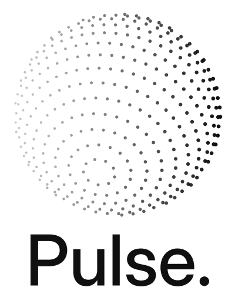

<h1 align="center">
  <picture align="center">
    <source media="(prefers-color-scheme: dark)" srcset="./assets/pulse-readme-dark.svg">
    
  </picture>
</h1>

<p align="center">
  An experimental, stylized Pomodoro timer.
</p>

<p align="center">
  <a href="https://www.rust-lang.org/"></a>
  <a href="https://github.com/anomalyco/rune"></a>
  
  
</p>

---

## 📖 About

Pulse is an experimental desktop Pomodoro timer built with Rust and Rune. With Pulse I really wanted to put an emphasis on having a minimal design and a calming user experience.

I wanted to develop Pulse as a personal project to improve at Rust and learn the Rune UI framework.

---

## ✨ Features

- Minimal UI
- Pomodoro timer

---

## 🧩 Roadmap

- [x] Functional countdown
- [ ] Reset and skip controls
- [ ] Focus and break sessions
- [ ] Animated particle visualization
- [ ] Procedural ambient music

---

## 🛠️ Technologies Used

- **[Rust](https://www.rust-lang.org/)**: App logic
- **[Rune](https://github.com/anomalyco/rune)**: UI and GPU rendering

---

## 📚 Getting Started

Make sure you have Rust and Cargo installed.

```bash
git clone https://github.com/ItaiHammer/pulse-pomo.git
cd pulse-pomo
cargo run
```

> **Note:** Rune is currently in pre-release. Pulse uses a pinned development revision. Development is currently tested on Windows.

---

## 📜 License

Pulse is licensed under the [MIT License](LICENSE).
